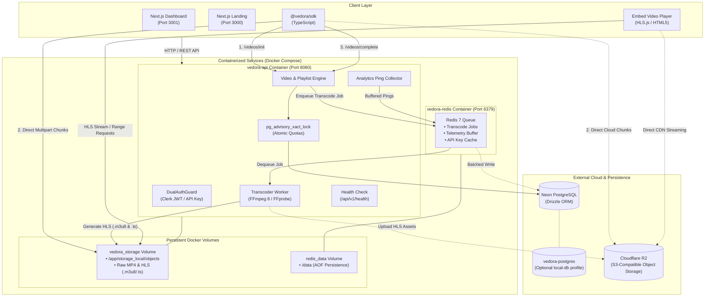
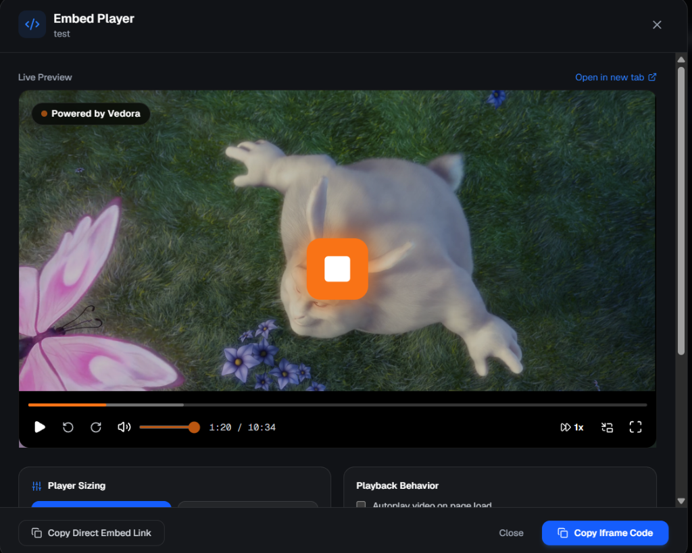

# Vedora — Video Infrastructure Platform

**Vedora** is an open-source, developer-first video infrastructure platform designed for ingesting, managing, and delivering video content at scale. Built with a modern TypeScript stack, it provides dual-layer authentication (Clerk JWTs & hashed API keys), multi-tier caching (in-memory LRU + Redis), atomic quota enforcement with PostgreSQL advisory locks, direct-to-cloud chunked ingestion via a standalone TypeScript SDK, RFC 8216 HLS manifest generation, an embeddable video player, and privacy-preserving segment telemetry.

[](https://nodejs.org)
[](https://nestjs.com)
[](https://nextjs.org)
[](https://react.dev)
[](https://www.typescriptlang.org)
[](https://neon.tech)
[](https://orm.drizzle.team)
[](https://redis.io)
[-brightgreen)](docs/FFmpeg/README.md)
[](LICENSE)

---

> [!NOTE]
> **Local Development Architecture**: Vedora is currently configured for local multi-service development (`http://localhost:8080`, `http://localhost:3001`, `http://localhost:3000`). There is no public hosted cloud deployment URL at this time. Follow the [Quick Start](#-quick-start) section to spin up the full platform locally with Docker Compose and npm.

---

## 💡 Why Vedora?

Building custom video streaming capabilities from scratch introduces several critical infrastructure hurdles:
- **Application Server Crashes**: Proxying multi-gigabyte video uploads through standard HTTP controllers saturates server memory and event loops.
- **Race Conditions & Quota Bypasses**: Simple database reads and writes (`SELECT` then `INSERT`) permit concurrent upload requests to exceed user storage limits.
- **HLS Complexity**: Authoring adaptive multi-bitrate HLS streams (master playlists, rendition ladders, variant playlists) requires specialized RFC 8216 compliance.
- **Custom Player Overhead**: Developing an embeddable HTML5 video player with adaptive bitrate selection, keyboard shortcuts, buffering recovery, responsive aspect ratios, and custom branding requires hundreds of lines of boilerplate.
- **Privacy-Preserving Metrics**: Ingesting high-frequency video playback heartbeats without storing raw PII or overwhelming the transactional database.

Vedora addresses these challenges with an integrated, developer-first platform: direct-to-cloud chunked presigned uploads, PostgreSQL advisory locks for quota reservations, asynchronous manifest generation, customizable embed players, and high-throughput batched telemetry.

---

## ⚡ Core Capabilities

1. **Direct-to-Cloud Ingestion, Cloudflare R2 & Background Queue**:
   Video files are sliced and uploaded directly to Cloudflare R2 using presigned multipart chunk URLs with bounded exponential backoff retries and `AbortSignal` cancellation. Dashboard uploads run inside a non-blocking right sidebar queue with real-time transfer telemetry (MB/s speed, ETA), allowing users to browse without interruption.
2. **Dual-Layer Authentication & Multi-Tier Caching**:
   `DualAuthGuard` validates either Clerk session JWTs (for dashboard users) or high-entropy API keys (`VDR_<32hex>_<secret>`). Keys are hashed with Argon2id; verification follows a 3-tier sequence (L1 local in-memory LRU, L2 Redis with HMAC-SHA256 digest keys, L3 Neon PostgreSQL).
3. **Atomic Quota Enforcement via PostgreSQL Advisory Locks**:
   PostgreSQL transaction-level advisory locks (`pg_advisory_xact_lock`) serialize concurrent upload requests per user, guaranteeing that active storage plus incoming reservations never exceed tier caps.
4. **Automatic Adaptive Rendition Ladder with Quality Ceilings**:
   Users select a maximum quality ceiling (360p, 480p, 720p, 1080p). Vedora automatically encodes all supported lower renditions down to 360p (e.g. 720p $\to$ 360p + 480p + 720p) with strict no-upscaling guarantees, generating RFC 8216 `master.m3u8` manifests and `.ts` media segments. Built-in `<VedoraPlayer />` and `<EmbedVideoModal />` provide adaptive bitrate streaming via `hls.js`.
5. **Privacy-Preserving Telemetry & Usage-Based Billing**:
   Playback heartbeat pings are pseudonymized using HMAC-SHA256, buffered in Redis, and asynchronously persisted to PostgreSQL in batched windows (`7d`, `30d`, `90d`). Stripe webhook listeners sync subscription tiers and manage monthly playback-minute resets.

---

## 🏗️ Architecture & Data Flow



---

## 📸 Product Preview

### Embed Video Player Modal
Full-featured interactive video player modal with responsive (16:9) and fixed pixel aspect ratios, live HLS/MP4 preview, custom brand watermark, player theme colors, and instant iframe embed code generation:



### Video Management Dashboard
User video library displaying lifecycle status badges (`uploading`, `uploaded`, `processing`, `ready`, `failed`), multi-resolution encoding presets (720p/1080p), playlist filtering, size/duration metrics, and direct embed code extraction:


### Interface Walkthrough Checklist
| View | Route | Implemented & Verified Capabilities |
| :--- | :--- | :--- |
| **API Keys Management** | `/` (Dashboard Root) | Argon2id key generation, one-time reveal modal, 5-minute cooldown regeneration, revocation |
| **Playlists Management** | `/playlists` | Playlist creation, user-scoped limit checks (10 max), atomic video count increments |
| **Direct Upload Studio** | `/uploads` | Drag-and-drop ingestion, quality ceiling selector (360p-1080p), persistent right sidebar queue with real-time speed & ETA |
| **Video Library** | `/my-videos` | Real-time TanStack Query cache, grid/table view, lifecycle badges, embed code modal launcher |
| **Embeddable Player** | `/embed/[videoid]` | Standalone viewport playback, HLS.js adaptive streaming, speed selector, PiP, keyboard shortcuts |
| **Custom Player Settings**| `/player` | Primary color picker, control bar styling, watermark position/opacity slider, UI control toggles |
| **Playback Analytics** | `/analytics` | Views, watch minutes, unique viewers, retention curve, device/browser distribution via Recharts |
| **Subscription Billing** | `/billing` | Active plan tier, allocated vs used playback minutes, renewal dates, Stripe checkout links |

---

## 🚀 Quick Start

### Option A: Docker Compose (Recommended & Fully Reproducible)

The fastest and most reproducible way to run Vedora is using Docker Compose. The containerized stack bundles the NestJS API gateway, background transcoder worker, system FFmpeg/FFprobe binaries, and Redis 7 into a hardened multi-stage Alpine runner.

```bash
# 1. Clone repository and navigate to root
git clone https://github.com/KartikaySingh0211/vedora.git
cd vedora

# 2. Configure environment variables
cp .env.example .env
# Set DATABASE_URL to your Neon PostgreSQL connection string (or use the offline local-db profile below)

# 3. Build and launch the containerized stack (API + FFmpeg Transcoder + Redis 7)
docker compose up -d

# 4. Apply database schema migrations inside the running API container
docker compose exec api npm run db:migrate

# 5. Verify stack health and API accessibility
curl http://localhost:8080/api/v1/health
# Output: {"status":"ok","dependencies":{"database":"up","redis":"up"}}
```

> [!NOTE]
> **Database Architecture**: Vedora uses `@neondatabase/serverless` with WebSocket connection pooling. A remote Neon Serverless PostgreSQL instance is the primary and recommended database. The containerized `local-db` profile (`docker compose --profile local-db up -d`) provides a standard PostgreSQL 16 instance for external TCP database tools and schema inspection.

---

### Option B: Bare-Metal Node.js Development

For local frontend or backend feature development without containerizing the Node processes:

#### 1. Prerequisites
- **Node.js**: `v20.x` or `v24.x` (LTS recommended)
- **Docker Desktop**: For running Redis 7 (`docker compose up -d redis`)
- **FFmpeg**: System `ffmpeg` and `ffprobe` in your `PATH` (or `@ffmpeg-installer`)
- **PostgreSQL Database**: Neon serverless connection string (or local PostgreSQL 16+)
- **Clerk Authentication**: Free Clerk account with Publishable & Secret keys

#### 2. Workspace Installation
Install dependencies in each workspace:

```bash
# Backend services
cd services
npm install

# TypeScript SDK
cd ../sdks/vedora-sdk
npm install
npm run build

# Dashboard application
cd ../../apps/main-dashboard
npm install

# Landing page
cd ../landing-page
npm install
```

#### 3. Environment Configuration
```bash
cp services/.env.example services/.env
cp apps/main-dashboard/.env.example apps/main-dashboard/.env
cp apps/landing-page/.env.example apps/landing-page/.env
```

#### 4. Run Applications Locally
```bash
# Terminal 1: Distributed Cache & Queue
docker compose up -d redis

# Terminal 2: Apply Migrations & Run Backend API (port 8080)
cd services
npm run db:migrate
npm run start:dev

# Terminal 3: Main Dashboard (port 3001)
cd apps/main-dashboard
npm run dev -- -p 3001

# Terminal 4: Marketing Landing Page (port 3000)
cd apps/landing-page
npm run dev -- -p 3000
```

### 📖 Interactive API Documentation (Swagger)
Once the backend is running (via Docker or Node), open the interactive Swagger UI:
- **Swagger UI**: [http://localhost:8080/api/docs](http://localhost:8080/api/docs)
- **OpenAPI 3.0 Spec**: Statically exported at [`docs/openapi.json`](docs/openapi.json)

---

## 🧪 Testing & Verification

Run tests, typechecks, and builds across all workspaces:

```bash
# 1. Backend unit & integration test suite (128 tests across 17 suites)
cd services
npm test

# 2. Backend TypeScript compilation
npm run build

# 3. TypeScript SDK test suite
cd ../sdks/vedora-sdk
npm test

# 4. Main dashboard typecheck & build
cd ../../apps/main-dashboard
npx tsc --noEmit
npm run build

# 5. Landing page typecheck & build
cd ../landing-page
npm run build
```

---

## 🏛️ Technical Architecture & Engineering Decisions

Vedora's design decisions are documented as formalized **Architecture Decision Records (ADRs)** in [`docs/decisions/`](docs/decisions/):

| Record | Focus | Core Problem & Engineering Trade-Off |
| :--- | :--- | :--- |
| **[ADR-001](docs/decisions/ADR-001-api-key-security-and-caching.md)** | API Key Security & Multi-Tier Caching | Plaintext keys cannot be stored in database or Redis. Solved via Argon2id database hashes + HMAC-SHA256 derived cache keys across a 3-tier cache (L1 LRU, L2 Redis, L3 DB). |
| **[ADR-002](docs/decisions/ADR-002-dual-authentication-guard.md)** | Dual-Authentication Guard | Unifies Clerk browser session JWTs and machine-to-machine API keys into a single `DualAuthGuard` attaching a normalized `req.user`. |
| **[ADR-003](docs/decisions/ADR-003-debounced-last-used-tracking.md)** | Debounced Activity Tracking | Updating `last_used_at` on every request creates write amplification. Solved with a 60-second Redis debounce filter before writing to PostgreSQL. |
| **[ADR-004](docs/decisions/ADR-004-database-quota-concurrency.md)** | Concurrency-Safe Quota Enforcement | Prevents concurrent upload races via PostgreSQL transaction-level advisory locks (`pg_advisory_xact_lock(hashtext(userId))`). |
| **[ADR-005](docs/decisions/ADR-005-video-storage-token-proxy.md)** | Storage Token Proxy & Telemetry | Decouples cloud storage credentials from client devices using short-lived presigned upload authorizations. |
| **[ADR-006](docs/decisions/ADR-006-plan-based-quotas-and-direct-uploads.md)** | Plan-Based Storage Quotas | Accounts for both raw video sizes and projected transcoding output before issuing upload authorization. |
| **[ADR-007](docs/decisions/ADR-007-vedora-upload-sdk-architecture.md)** | Standalone TypeScript SDK | Custom `@vedora/sdk` client handling chunking, upload progress calculation, exponential backoff retries, and `AbortSignal` cancellation. |
| **[ADR-008](docs/decisions/ADR-008-hls-transcoding-and-rendition-ladder.md)** | Asynchronous HLS Transcoding | Multi-rendition adaptive streaming ladder (360p to 1080p), RFC 8216 master playlist generation, and HMAC webhook verification. |
| **[ADR-009](docs/decisions/ADR-009-segment-level-analytics-and-pseudonymous-telemetry.md)** | Playback Telemetry Ingestion | Ingests 10-second segment heartbeat pings, pseudonymizes client IP with HMAC-SHA256, buffers in Redis, and batches into PostgreSQL. |
| **[ADR-010](docs/decisions/ADR-010-subscription-billing-and-usage-accounting.md)** | Subscription Billing & Minute Accounting | Integrates Stripe webhooks (`customer.subscription.updated`, `invoice.paid`) and scheduled UTC monthly cron to reset playback minutes while preserving accrued storage. |
| **[ADR-011](docs/decisions/ADR-011-safe-modularity-and-frontend-reusability.md)** | Frontend Reusability & Embed Player | Encapsulates video streaming into a reusable `<VedoraPlayer />` and `<EmbedVideoModal />` with HLS.js adaptive streaming and native HTML5 fallback. |

---

## 📚 Engineering Documentation & Ledgers

- 📖 **[Master Engineering Log & Ledger (`docs/ENGINEERING_LOG.md`)](docs/ENGINEERING_LOG.md)**: Full chronological ledger documenting every implementation run, exact changes, design rationale, and test verification results.
- 📐 **[System Design & Architecture Document (`docs/ARCHITECTURE_AND_SYSTEM_DESIGN.md`)](docs/ARCHITECTURE_AND_SYSTEM_DESIGN.md)**: Deep architectural blueprints, threat modeling, multi-tier caching sequences, and telemetry engines.
- 🚀 **[Swagger / OpenAPI 3.0 API Documentation (`docs/api-docs/README.md`)](docs/api-docs/README.md)**: Comprehensive developer API reference, Swagger UI configuration, DTO schemas, dual authentication, webhooks, and client generation.
- 🌐 **[Raw OpenAPI 3.0 Specification (`docs/openapi.json`)](docs/openapi.json)**: Fully typed, machine-readable OpenAPI 3.0 specification for Postman, Insomnia, and SDK code generation.
- 🛠️ **[Bug Fixes & Incident Ledger (`docs/bug-fixes/README.md`)](docs/bug-fixes/README.md)**: Immutable record of incidents, root-cause analyses, and resolutions (BUG-001 through BUG-011).

---

## 🛡️ Security Best Practices Implemented

1. **Zero Plaintext Storage**: Plaintext API keys (`VDR_<hex>_<secret>`) are returned exactly once upon creation. Only Argon2id hashes are stored in PostgreSQL.
2. **Dedicated HMAC Digest Cache Keys**: Plaintext keys are never stored in Redis. Only HMAC-SHA256 digests derived with server-side secrets are used for cache validation.
3. **Prompt Cache Invalidation**: Revoking or regenerating an API key invalidates both Level 1 (LRU) and Level 2 (Redis) cache entries immediately and guards against concurrent rehydration.
4. **Server-Side Quotas**: Quotas (e.g., 10 playlists per user, plan storage caps) are enforced in PostgreSQL transactions using advisory locks, preventing quota bypasses from concurrent race conditions.
5. **Privacy-Preserving Telemetry**: Raw IP addresses are never persisted in analytics records; pseudonymized HMAC hashes are generated with server-side secrets.
6. **Cryptographic Webhook Signatures**: Transcoding completion and Stripe billing webhooks require verified HMAC signatures before executing state transitions.
7. **Server-Authoritative Plan Entitlements**: Client applications cannot override watermarks, resolution caps, or subscription tiers; all playback and quota logic is verified server-side.
8. **Permanent Storage Accounting**: Monthly billing resets refresh playback minutes while preserving accrued storage size to guarantee accurate quota enforcement across billing cycles.

---

## ⚠️ Known Limitations & Active Fallbacks

To maintain complete technical transparency:
1. **Storage Ingestion & Multi-Provider Architecture**:
   Vedora supports **Cloudflare R2** directly through native S3-compatible multipart presigned uploads with zero egress fees. When Cloudflare R2 credentials (`R2_ACCOUNT_ID`, `R2_ACCESS_KEY_ID`, `R2_SECRET_ACCESS_KEY`, `R2_BUCKET_NAME`) are supplied, uploads and HLS media route straight to R2. If cloud credentials are absent or in local development mode, Vedora automatically activates its built-in **Resilient Storage Provider Fallback**, assembling chunks in local storage (`services/storage_local/`) and streaming media through HTTP 206 Partial Content range requests.
2. **Real FFmpeg Transcoding Worker**:
   The background transcode worker executes real FFmpeg and FFprobe binary pipelines (probed stream topology, upscaling prevention, H.264/AAC encoding, and RFC 8216 HLS master and variant playlist generation with playable `.ts` segments). Full technical documentation and verification logs are maintained in [docs/FFmpeg/README.md](docs/FFmpeg/README.md). Dedicated distributed GPU fleets remain on the roadmap for multi-node deployments.
3. **Deployment Hosting**:
   The platform is currently optimized for local multi-service development. A hosted public production deployment is part of the roadmap.

---

## 🗺️ Roadmap

- [x] **Cloudflare R2 Native Storage Driver**: Native S3-compatible driver support with 0 egress fees.
- [ ] **Distributed FFmpeg Worker Fleet**: Containerized GPU-accelerated video encoding worker pool.
- [ ] **AI-Powered Subtitles**: Automated multi-language subtitle generation via Whisper AI worker hooks.
- [ ] **Team & Organization RBAC**: Multi-tenant team workspaces with granular permission tiers.
- [ ] **Automated CI/CD Pipeline**: GitHub Actions workflows for continuous integration, linting, and automated Docker container builds.

---

## 📄 License

This project is licensed under the [MIT License](LICENSE).
