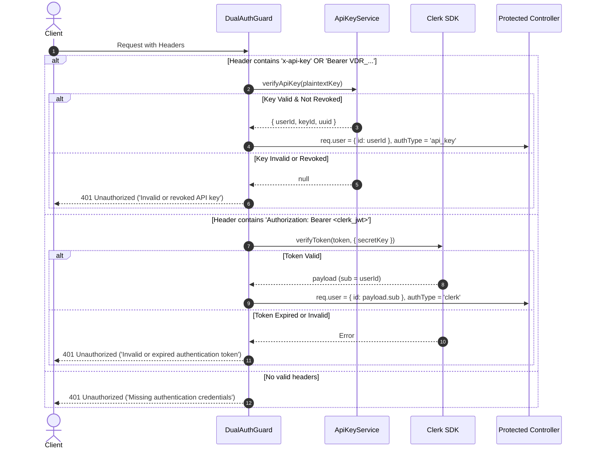
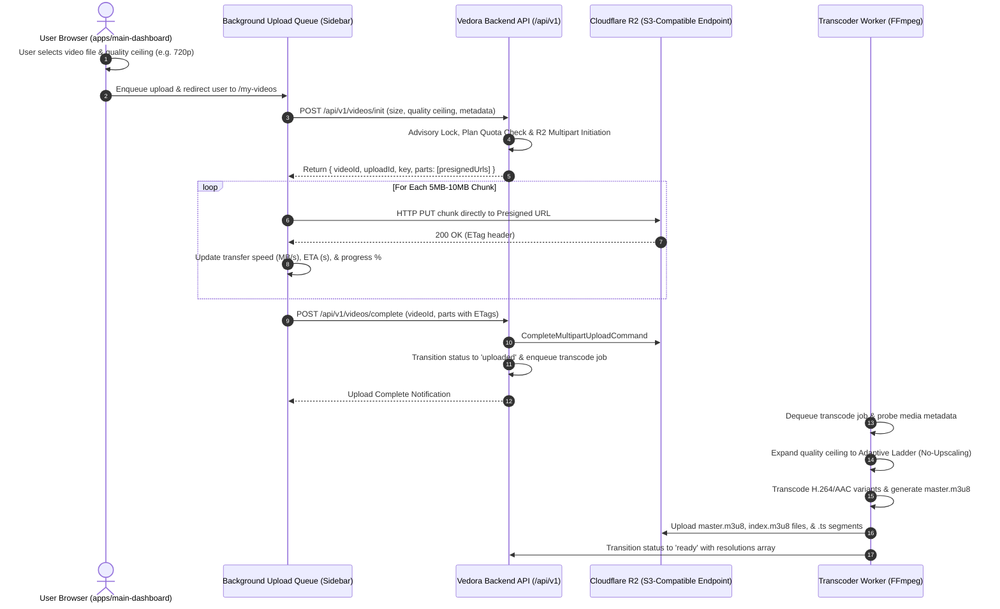

# Vedora Architecture & System Design Document

This document provides the canonical architectural specification, security threat models, data flows, and infrastructure blueprints for the **Vedora Video Infrastructure SaaS Platform**.

---

## 1. High-Level System Architecture

Vedora is structured as a decoupled monorepo separating customer-facing interfaces, authenticated dashboard workflows, and high-performance backend media ingestion APIs.

```mermaid
graph TD
    ClientBrowser[Client Web Browser] -->|Port 3000| LandingApp[apps/landing-page Next.js]
    ClientBrowser -->|Port 3001| DashboardApp[apps/main-dashboard Next.js]
    
    DashboardApp -->|Clerk Bearer Auth / REST| BackendAPI[services NestJS API Port 8080]
    DevClient[Third-Party Developer Server] -->|x-api-key: VDR_...| BackendAPI
    
    subgraph Backend Services Architecture
        BackendAPI --> DualAuth[Dual-Authentication Guard]
        DualAuth -->|User JWT| ClerkAuth[Clerk Backend SDK]
        DualAuth -->|VDR API Key| KeyService[ApiKeyService]
        
        KeyService --> Level1LRU[Level 1: Local In-Memory LRU]
        KeyService --> Level2Redis[Level 2: Redis 7 Distributed Cache]
        KeyService --> Level3DB[Level 3: Neon PostgreSQL + Argon2id]
        
        BackendAPI --> PlaylistService[PlaylistService + Advisory Lock]
        PlaylistService --> Level3DB
        
        ActivityWorker[Scheduled Flush Worker 5m] -->|Atomic Batch UPDATE| Level3DB
        BackendAPI --> ActivityBuffer[Debounced Redis Buffer 60s]
        ActivityBuffer -.-> ActivityWorker
    end
    
    subgraph Storage Ingestion Pipeline
        DashboardApp -->|1. POST /api/v1/videos/init| BackendAPI
        BackendAPI -->|Generate Presigned Multipart URLs| StorageService[StorageService (S3 Client)]
        StorageService -->|S3 Multipart Upload Parts| CloudflareR2[Cloudflare R2 Bucket]
        BackendAPI -->|Return Presigned URLs| DashboardApp
        DashboardApp -->|2. Direct Multipart Chunk Streaming| CloudflareR2
        DashboardApp -->|3. POST /api/v1/videos/complete| BackendAPI
    end
```

---

## 2. Authentication & Credential Architecture

### 2.1 Dual-Authentication Guard

Vedora serves two distinct consumer types:
1. **Human Operators**: Accessing `apps/main-dashboard` via Clerk user sessions (JWT Bearer tokens).
2. **Automated Backend Pipelines**: Machine-to-machine integrations using Vedora API Keys (`VDR_<32hex>_<secret>`).



### 2.2 API Key Cryptographic Specification

Newly issued keys strictly follow the format:
```text
VDR_<32-character-hex-key-id>_<base64url-secret>
```

- **Prefix**: `VDR_` identifies the key provider.
- **Key ID**: 16 bytes of cryptographically secure pseudorandom randomness (`crypto.randomBytes(16).toString('hex')`). This yields 32 hex characters (128 bits).
  - *Database Mapping*: The 32 hex characters directly map to standard RFC 4122 UUID:
    ```typescript
    keyId.slice(0,8) + '-' + keyId.slice(8,12) + '-' + keyId.slice(12,16) + '-' + keyId.slice(16,20) + '-' + keyId.slice(20)
    ```
    This allows PostgreSQL to perform an indexed primary-key lookup (`WHERE id = :uuid`) in $O(1)$ time without scanning tables.
- **Secret**: 32 bytes of secure random bytes encoded as URL-safe Base64 (43 characters).
- **Plaintext Lifecycle**: Generated once, returned only in the initial creation response, and never persisted.
- **Database Hashing**: Stored as an **Argon2id** hash (`m=65536, t=3, p=1`) in the `api_key.value` column.
- **Cache Digest Indexing**: Plaintext keys are **never** used as Redis keys or stored in Redis values. Instead, an **HMAC-SHA256** digest is computed using a server-side secret (`API_KEY_DIGEST_SECRET`):
  $$\text{Digest} = \text{HMAC-SHA256}(\text{key}, \text{API\_KEY\_DIGEST\_SECRET})$$
  The digest is stored in the cache record. A cache hit requires:
  $$\text{DerivedDigest}(\text{IncomingKey}) == \text{CachedDigest}$$

---

## 3. Multi-Tier Caching & Invalidation Architecture

To provide single-digit millisecond latency while protecting the Neon PostgreSQL database from connection and compute saturation, API key validation is structured in three strictly ordered layers:

```mermaid
flowchart TD
    Start[Incoming API Request] --> Parse[Format Validation / Fast Regex]
    Parse -->|Invalid Format| Reject[401 Unauthorized - O(1) Rejection]
    
    Parse -->|Valid Format| Derive[Compute HMAC-SHA256 Digest]
    Derive --> L1{Level 1: Local In-Memory LRU?}
    
    L1 -->|Hit & Not Revoked & Digest Match| Authenticate[200 Authenticated]
    L1 -->|Hit & Revoked| RejectRevoked[401 Unauthorized - Cached Revoked]
    
    L1 -->|Miss| L2{Level 2: Redis Distributed Cache?}
    L2 -->|Hit & Digest Match| RehydrateL1[Rehydrate Level 1 LRU Cache] --> Authenticate
    L2 -->|Hit & Revoked| CacheL1Revoked[Cache Revoked in L1] --> RejectRevoked
    
    L2 -->|Miss / Redis Down| L3{Level 3: Neon PostgreSQL Primary Key Lookup}
    L3 -->|Not Found| Reject
    L3 -->|Found & revoked_at NOT NULL| CacheRevokedAll[Cache Revoked in L1 & L2] --> RejectRevoked
    L3 -->|Found & Active| VerifyArgon2{Verify Plaintext vs Argon2id Hash}
    
    VerifyArgon2 -->|Hash Mismatch| Reject
    VerifyArgon2 -->|Hash Valid| PopulateAll[Populate L1 & L2 with HMAC Digest] --> Authenticate
```

### Cache Invalidation Protocol
When an API key is revoked or regenerated:
1. Level 1 LRU cache key `v1:<keyId>` is deleted.
2. Level 2 Redis cache key `vedora:api_key:v1:<keyId>` is deleted.
3. PostgreSQL is updated: `UPDATE api_key SET revoked_at = NOW() WHERE id = :uuid AND user_id = :userId`.
4. LRU and Redis are invalidated a second time post-commit to eliminate any concurrent read race condition.

---

## 4. Debounced Last-Used Activity Tracking

Writing to PostgreSQL on every authenticated API request would rapidly exhaust database connection pools and write IOPS. Vedora implements an asynchronous debounced buffering pattern:

```mermaid
sequenceDiagram
    autonumber
    participant Client
    participant API as ApiKeyService
    participant Redis as Redis Service
    participant Scheduler as Scheduled Activity Worker (5m)
    participant DB as Neon PostgreSQL

    Client->>API: Authenticated API Call
    API->>Redis: SET vedora:api_key:last_used_lock:v1:<keyId> '1' EX 60 NX
    alt Lock Acquired (First request in 60s window)
        Redis-->>API: OK (Lock Acquired)
        API->>Redis: HSET vedora:api_key:last_used:v1 <uuid> <ISO_Timestamp>
    else Lock Not Acquired (Within 60s debounce window)
        Redis-->>API: NULL (Debounced - Skip write)
    end
    API-->>Client: Process & Return API Response

    Note over Scheduler: Every 5 Minutes (@Cron)
    Scheduler->>Redis: SET vedora:api_key:flush_lock '1' EX 120 NX
    Scheduler->>Redis: HGETALL vedora:api_key:last_used:v1
    Redis-->>Scheduler: { uuid_1: ts_1, uuid_2: ts_2, ... }
    
    Scheduler->>DB: BEGIN TRANSACTION
    loop For Each UUID
        Scheduler->>DB: UPDATE api_key SET last_used_at = ts WHERE id = uuid AND revoked_at IS NULL
    end
    Scheduler->>DB: COMMIT TRANSACTION
    
    alt Commit Succeeded
        Scheduler->>Redis: HDEL vedora:api_key:last_used:v1 [uuid_1, uuid_2, ...]
    else Commit Failed
        Note over Scheduler: Leave entries in Redis; retry on next cycle
    end
    Scheduler->>Redis: DEL vedora:api_key:flush_lock
```

### Self-Healing Redis Fallback
If Redis is down or unreachable:
1. `RedisService` marks `isConnected = false` and suppresses unhandled exceptions.
2. Activity tracking falls back to an in-memory debounced map (`memoryActivity`).
3. During scheduled flushes, in-memory activity is merged and committed to PostgreSQL.
4. Authentication seamlessly falls back to Level 3 PostgreSQL lookups without failing client requests.

---

## 5. Playlist Quota & Concurrency Controls

### 5.1 Quota Specification
- Default quota: **10 playlists per user**.
- Enforcement layer: **Server-side database transaction**. Client-side UI disables the button as a UX convenience, but server rejects unauthorized attempts.

### 5.2 Concurrency Race-Condition Prevention
To prevent two simultaneous requests from creating 11 playlists:

```mermaid
sequenceDiagram
    autonumber
    actor UserClient1 as Request 1 (Client A)
    actor UserClient2 as Request 2 (Client B)
    participant Service as PlaylistService
    participant DB as Neon PostgreSQL

    par Simultaneous Requests from Same User (Current Count = 9)
        UserClient1->>Service: POST /api/v1/playlists
        Service->>DB: BEGIN TRANSACTION (Tx 1)
        Service->>DB: SELECT pg_advisory_xact_lock(hashtext('vedora_playlist_quota_' || userId))
        Note over DB: Tx 1 acquires Advisory Lock for User
    and
        UserClient2->>Service: POST /api/v1/playlists
        Service->>DB: BEGIN TRANSACTION (Tx 2)
        Service->>DB: SELECT pg_advisory_xact_lock(hashtext('vedora_playlist_quota_' || userId))
        Note over DB: Tx 2 BLOCKS waiting for Tx 1 lock release
    end

    Service->>DB: (Tx 1) SELECT COUNT(*) FROM playlist WHERE user_id = userId
    DB-->>Service: (Tx 1) Count = 9 (Quota OK)
    Service->>DB: (Tx 1) INSERT INTO playlist ...
    Service->>DB: (Tx 1) COMMIT
    Note over DB: Tx 1 commits; Advisory Lock released to Tx 2

    Service->>DB: (Tx 2) SELECT COUNT(*) FROM playlist WHERE user_id = userId
    DB-->>Service: (Tx 2) Count = 10 (Quota Exceeded!)
    Service-->>UserClient2: 400 Bad Request ('Playlist quota exceeded')
```

---

## 6. Video Ingestion, Cloudflare R2 & Adaptive Transcoding Architecture


```

### Telemetry Calculation Engine
To prevent division-by-zero, negative intervals, or `NaN`/`Infinity` artifacts:
$$\text{ElapsedSeconds} = \max\left(0.1, \frac{\text{Date.now}() - \text{StartTime}}{1000}\right)$$
$$\text{LoadedBytes} = \text{TotalBytes} \times \left(\frac{\text{Percent}}{100}\right)$$
$$\text{SpeedBytesPerSec} = \frac{\text{LoadedBytes}}{\text{ElapsedSeconds}}$$
$$\text{RemainingSeconds} = \left\lceil \frac{\text{TotalBytes} - \text{LoadedBytes}}{\text{SpeedBytesPerSec}} \right\rceil$$

If progress is $100\%$, the UI transitions immediately to `"Finalizing multipart upload..."` until the provider returns confirmation.
