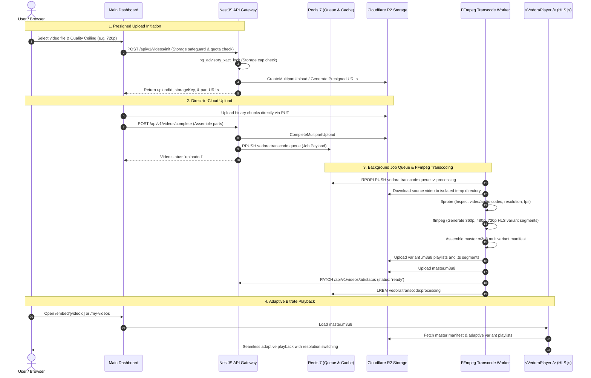
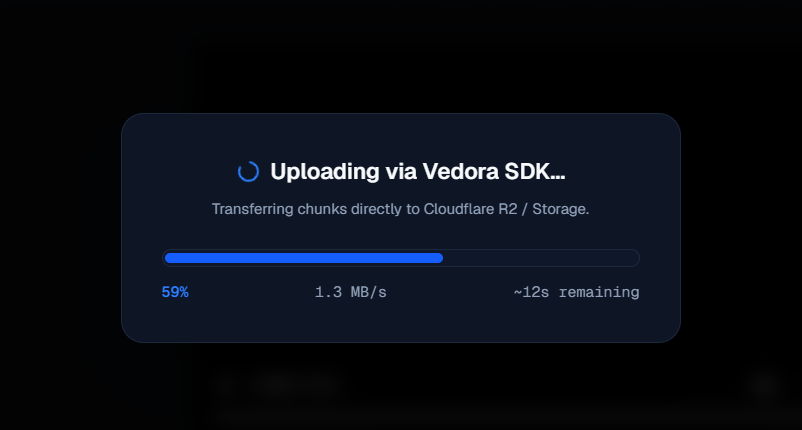
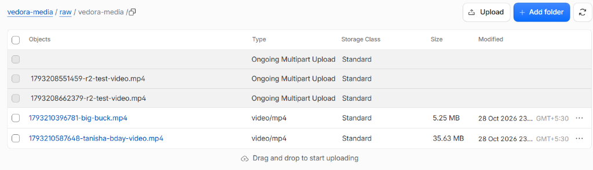
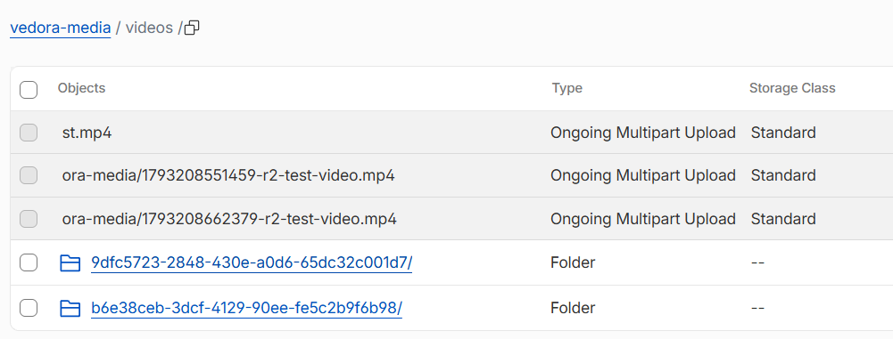
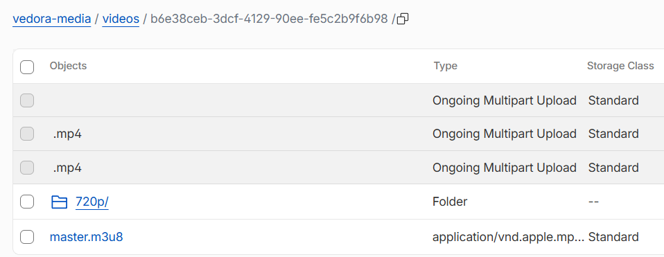
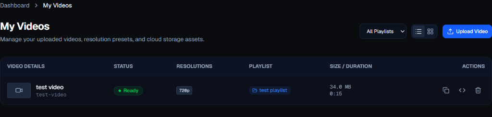

# Vedora End-to-End Walkthrough & Demonstration Guide

This guide provides visual and programmatic walkthrough evidence of the complete Vedora video lifecycle: **Direct Client Upload $\to$ Cloudflare R2 Raw Storage $\to$ Redis Job Queue $\to$ FFmpeg Adaptive HLS Packaging $\to$ Multi-Rendition Cloudflare R2 Delivery $\to$ Embedded Video Playback**.

---

## 1. Complete Architecture Lifecycle Walkthrough



---

## 2. Visual Demonstration Gallery

### Step 1: Direct Upload Studio (`/uploads`)
Users drag-and-drop video files into the upload studio. Vedora enforces server-side technical safeguards (10 GiB single-file limit, 500 GiB user quota) and allows selecting an adaptive quality ceiling (360p to 1080p). Active uploads are tracked in the persistent background queue sidebar with real-time transfer speeds and progress bars.



---

### Step 2: Raw Ingestion Zone in Cloudflare R2 (`raw/`)
The original high-resolution master video is uploaded directly from the browser to Cloudflare R2 using AWS SDK S3 presigned multipart URLs, ensuring zero server-bandwidth overhead:



---

### Step 3: Master Manifest Generation (`videos/<uuid>/master.m3u8`)
Following FFmpeg background processing, the multi-resolution HLS manifest is assembled and stored in the video's root storage directory alongside variant resolution subdirectories:



---

### Step 4: Variant Rendition Folders & MPEG-TS Segments (`720p/`)
Each rendition contains an RFC 8216-compliant `index.m3u8` variant playlist and uniform 4-second MPEG-2 Transport Stream media chunks (`segment_000.ts`, `segment_001.ts`...):



---

### Step 5: Video Library Management (`/my-videos`)
The video management dashboard tracks lifecycle status transitions (`uploading` $\to$ `uploaded` $\to$ `processing` $\to$ `ready`), video duration, file sizes, and rendition badges with real-time TanStack Query synchronization:



---

### Step 6: Responsive Adaptive Playback (`<VedoraPlayer />`)
The embeddable player modal provides adaptive bitrate streaming via HLS.js, rendition quality selection, playback speed controls, picture-in-picture (PiP), custom brand watermarks, and instant iframe embed code extraction:


---

## 3. How to Run the Demonstration Locally

Follow these steps to run and verify the entire upload-to-playback demonstration on a local workstation:

```bash
# 1. Start backend services and Redis
cd services
npm install
npm test -- transcoder-live-e2e.spec.ts   # Runs full synthetic FFmpeg transcoding pipeline
npm run start:dev

# 2. In a second terminal, start the main dashboard
cd apps/main-dashboard
npm ci
npm run dev

# 3. Open http://localhost:3000 in your browser
# - Navigate to /uploads to perform a live upload
# - Navigate to /my-videos to inspect real-time status transitions
# - Open /embed/[videoid] to test HLS adaptive streaming
```
