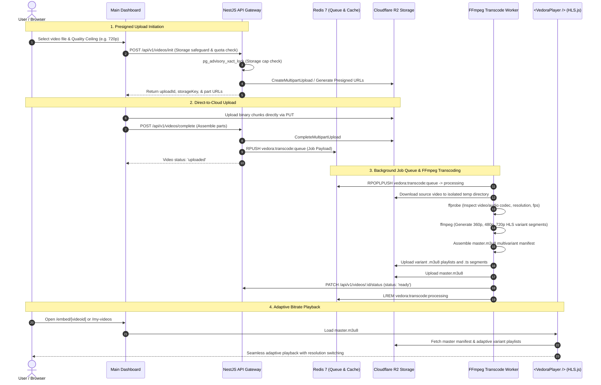
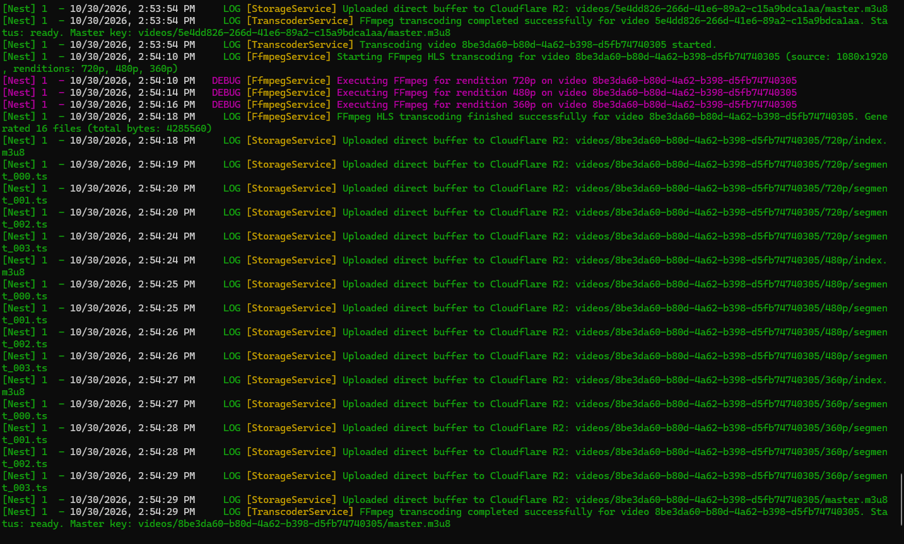
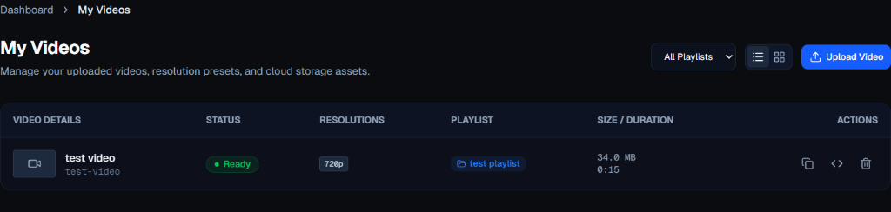
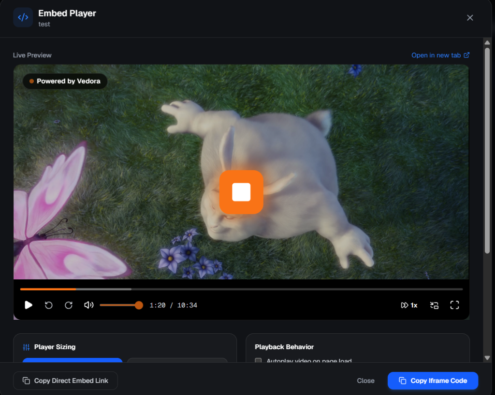

# Vedora End-to-End Walkthrough & Demonstration Guide

This guide provides visual, architectural, and operational walkthrough evidence of the complete Vedora video lifecycle: **Direct Client Upload $\to$ Cloudflare R2 Raw Storage $\to$ Redis Job Queue $\to$ FFmpeg Adaptive HLS Packaging $\to$ Multi-Rendition Cloudflare R2 Delivery $\to$ Embedded Video Playback**.

---

## 1. Complete Architecture Lifecycle Walkthrough



---

## 2. Demonstration Videos

Vedora's full operational lifecycle and cloud storage integrations are captured in two high-definition demonstration screencasts:

### 2.1 Complete Application Walkthrough
- 🎥 **Video File**: [Watch Application Walkthrough](main-walkthrough.mp4)
- **Lifecycle Scope**: Demonstrates the end-to-end user experience and operational workflow across the platform:
  1. **Dashboard & API Keys**: Inspecting active API keys, one-time reveal modals, and key regeneration with cooldown controls.
  2. **Non-Blocking Sidebar Uploads (`/uploads`)**: Drag-and-drop video ingestion, selecting an adaptive quality ceiling (360p to 1080p), and simultaneously uploading multiple files inside the persistent right sidebar queue with real-time transfer telemetry (MB/s throughput and ETA countdowns).
  3. **Lifecycle State Transitions (`/my-videos`)**: Real-time status transitions (`uploading` $\to$ `uploaded` $\to$ `processing` $\to$ `ready`) synchronized via TanStack Query.
  4. **Adaptive HLS Playback (`<VedoraPlayer />`)**: Opening the responsive player modal, adaptive stream resolution switching, playback rate controls, and picture-in-picture (PiP).
  5. **Network Request Inspection**: Verifying client-side retrieval of the multivariant `master.m3u8` playlist, variant rendition manifests (`720p/index.m3u8`), and uniform MPEG-2 Transport Stream media chunks (`segment_000.ts`).
  6. **Player Customization (`/player`)**: Adjusting player accent colors, control bar themes (including transparent backgrounds), watermark positions, and toolbar controls.

### 2.2 Cloudflare R2 Storage Walkthrough
- 🎥 **Video File**: [Watch Cloudflare R2 Walkthrough](R2.mp4)
- **Object Storage Inspection**: Deep dive into the physical Cloudflare R2 bucket hierarchy confirming clean separation between raw master video uploads and generated multi-resolution HLS media artifacts:

```text
cloudflare-r2-bucket/
├── raw/
│   └── <videoId>.<ext>                 # Original un-transcoded master video
└── videos/
    └── <videoId>/
        ├── master.m3u8                 # RFC 8216 multivariant master playlist
        ├── 1080p/                      # 1080p FHD rendition folder
        │   ├── index.m3u8              # 1080p variant media playlist
        │   ├── segment_000.ts          # Uniform 4-second MPEG-TS chunks
        │   └── segment_001.ts
        ├── 720p/                       # 720p HD rendition folder
        │   ├── index.m3u8              # 720p variant media playlist
        │   ├── segment_000.ts
        │   └── segment_001.ts
        ├── 480p/                       # 480p SD rendition folder
        │   ├── index.m3u8
        │   └── segment_000.ts
        └── 360p/                       # 360p mobile rendition folder
            ├── index.m3u8
            └── segment_000.ts
```

- **Key Architectural Findings**:
  - **Zero Server Bandwidth Ingestion**: Video files are transferred directly from client browsers to Cloudflare R2 using AWS SDK S3 presigned multipart upload URLs.
  - **Standardized Multi-Resolution Output**: FFmpeg transcode workers unpack the raw source, generate the full adaptive ladder without quality upscaling, and upload each rendition's variant playlist and TS segments alongside the root `master.m3u8` multivariant playlist.

---

## 3. Visual Execution Evidence & Screenshots

### Background Transcoding Worker Execution Logs
Terminal output proving genuine background transcode worker execution: atomic Redis job claiming (`RPOPLPUSH`), FFprobe media topology inspection, multi-resolution ladder encoding (360p to 1080p with strict no-upscaling guards), multivariant RFC 8216 master manifest generation, and Cloudflare R2 artifact upload:


*Figure: Terminal execution logs from the Vedora background worker demonstrating real FFprobe probing, multi-ladder H.264/AAC transcoding, master manifest assembly, and database status updates.*

### Video Management Dashboard (`/my-videos`)
User video library tracking real-time status transitions, resolution badges, duration, file sizes, and embed launcher:


*Figure: Video library dashboard showing active lifecycle badges, duration metadata, and playback launcher.*

### Embed Video Player Modal (`/embed/[videoid]`)
Embed player modal featuring adaptive HLS streaming via HLS.js, rendition quality selector, playback speed, brand watermark, and iframe embed code generation:


*Figure: Interactive embed video player modal with responsive aspect ratio, quality level selector, and custom styling.*

---

## 4. How to Run the Demonstration Locally

Follow these steps to run and verify the entire upload-to-playback demonstration on a local workstation:

```bash
# 1. Start backend services and Redis
cd services
npm install
npm test -- transcoder-live-e2e.spec.ts   # Runs full synthetic FFmpeg transcoding pipeline
npm run start:dev

# 2. In a second terminal, start the main dashboard
cd apps/main-dashboard
npm install
npm run dev -- -p 3001

# 3. Open http://localhost:3001 in your browser
# - Navigate to /uploads to perform a live upload with sidebar queue tracking
# - Navigate to /my-videos to inspect real-time status transitions
# - Open /embed/[videoid] to test HLS adaptive streaming
```
